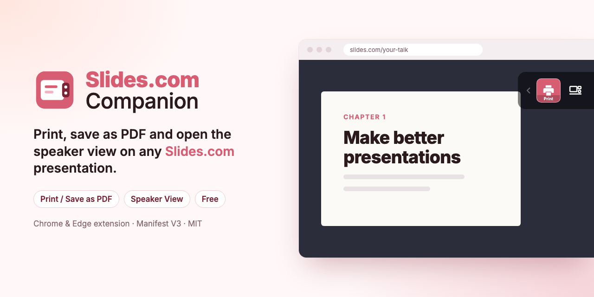

# Slides.com Companion



Chrome/Edge extension that aims to add a few missing features (free) to Slides.com presentations:

- **Print**: download any presentation as a PDF file using the print command of the browser.
- **Speaker view**: open Reveal.js's speaker view, with notes, timer and upcoming slide.

Other features are planned, like multi-screen presentation.

[Go to Chrome Web Store](https://chrome.google.com/webstore/detail/slidescom-downloader/bciknjamldhnbbckmgbchmkdcalngnco)

# Development

Built with [WXT](https://wxt.dev), Vue 3 and TypeScript. Requires Node 22 (`nvm use` reads `.nvmrc`).

```bash
npm install
npm run dev      # opens Chrome with the extension loaded and reloads it on change
```

To load a production build by hand:

- `npm run build`, which writes the extension to `.output/chrome-mv3`.
- Open [chrome://extensions](chrome://extensions) (or [edge://extensions](edge://extensions)), enable **Developer Mode**, click **Load unpacked** and select `.output/chrome-mv3`.

## Scripts

| Script                     | What it does                                                         |
| -------------------------- | -------------------------------------------------------------------- |
| `npm run dev`              | Development mode with auto-reload                                    |
| `npm run build`            | Production build in `.output/chrome-mv3`                             |
| `npm run zip`              | Zip for the Chrome Web Store in `.output/`                           |
| `npm run lint`             | ESLint                                                               |
| `npm run format`           | Prettier                                                             |
| `npm run typecheck`        | `vue-tsc`                                                            |
| `npm test`                 | Unit tests (Vitest)                                                  |
| `npm run test:e2e`         | Builds, then runs the e2e tests (Playwright) on a saved presentation |
| `npm run snapshot -- <url>` | Saves a public presentation as the e2e fixture                      |
| `npm run icons`            | Exports the PNG icons in `public/icons/` from the SVGs in `Chrome Web Store/icon/` |

The e2e tests need Playwright's Chromium: `npx playwright install chromium`.

## Structure

```
src/
  entrypoints/
    background.ts        enables the action on tabs with a presentation, injects the toolbar script
    content/             waits for the presentation, bridges settings, toolbar styles
    injected/            runs in the page (MAIN world): Vue toolbar and Reveal's notes plugin
    popup/               settings
  background/            background logic
  shared/                settings and logging
public/                  icons and popup images
tests/
  unit/                  Vitest
  e2e/                   Playwright
  fixtures/presentation/ saved presentation
```

---

<p align="center">
  Made by
  <a href="https://leicaflorianrobert.dev"></a>
  <a href="https://leicaflorianrobert.dev">Leica Florian Robert</a>
</p>
